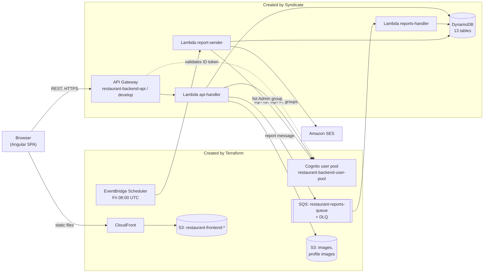

# Green Tasty: system architecture

This document explains how the parts of Green Tasty fit together and how they work today: where the frontend ends and the backend begins, how requests and events move between components, who is allowed to do what, where data lives, and how the system is configured and deployed. The product context is in [project-overview.md](project-overview.md).

Internal details of each application, such as Angular conventions or the full list of backend handlers, belong in separate per-application documents. This file stays at the level where the parts meet.

## 1. How to read this document

The text describes the repository as of 2026-10-29 (branch `hw-backend`, last commit `1adf4c8`). Every statement was checked against the file it links to. Anything that could not be confirmed from the repository is not written as fact; it is listed in [section 12, Open questions](#12-open-questions).

When the code and this document disagree, the code wins, and this document needs an update.

## 2. The system at a glance

Green Tasty is a monorepo with three independently deployed parts:

| Part | Path | What it is | Deployed with |
|---|---|---|---|
| Shared infrastructure | `infra/terraform` | Cognito, SQS, EventBridge Scheduler, S3 buckets, CloudFront | Terraform ≥ 1.10 |
| Backend | `backend/restaurant-backend-app` | Three .NET 10 Lambda functions, API Gateway, DynamoDB tables | AWS Syndicate |
| Frontend | `frontend/restaurant-frontend-app` | Angular 22 single-page application | `npm run build`, then `aws s3 sync` |

All of it runs in one AWS account in region `eu-north-1` ([variables.tf](../infra/terraform/variables.tf), [backend.tf](../infra/terraform/backend.tf)).

## 3. Where the frontend ends and the backend begins

The frontend is a static bundle. After the build it is a set of files in a private S3 bucket, served only through CloudFront: the bucket policy allows reads only to the CloudFront service principal of this distribution ([s3.tf](../infra/terraform/s3.tf), [cloudfront.tf](../infra/terraform/cloudfront.tf)). CloudFront answers S3 `403` and `404` errors with `/index.html` and status `200`, so deep links such as `/join/<token>` load the SPA, and Angular's router takes over in the browser.

The frontend has no server-side code and no AWS SDK: `package.json` has no AWS, Cognito or Amplify dependencies. Everything the SPA knows about data, it learns from one REST API whose base URL is the `backendUrl` value in its environment file (see [section 9](#9-configuration)). Sign-in also goes through that API (`POST /signin`), not directly to Cognito.

On the other side, the whole REST API is served by a single Lambda, `api-handler`. API Gateway declares each resource and method explicitly and passes requests to the Lambda as a proxy integration. The Lambda then routes requests itself ([Function.cs](../backend/restaurant-backend-app/dnapp/lambdas/api-handler/Function.cs), [RouteRegistry.cs](../backend/restaurant-backend-app/dnapp/lambdas/api-handler/Routing/RouteRegistry.cs)). Routing therefore happens in two places, and both must agree: the gateway decides whether a request reaches the Lambda and with which authorizer; `RouteRegistry` decides which handler runs.

The two other Lambdas have no HTTP interface. `reports-handler` is triggered by SQS and `report-sender` by EventBridge Scheduler.

## 4. How the components interact

### 4.1 A synchronous API request

1. The SPA sends a request through Angular `HttpClient`. The functional interceptor [token.interceptor.ts](../frontend/restaurant-frontend-app/src/app/auth/token.interceptor.ts) adds `Authorization: Bearer <idToken>` when the user is signed in. It leaves any URL that contains `/guest/` untouched; guest requests carry their own token (see [4.4](#44-group-pre-order)).
2. API Gateway (`restaurant-backend-api`, stage `develop`) checks the method's `authorization_type` in the top-level [deployment_resources.json](../backend/restaurant-backend-app/deployment_resources.json). For `cognito_authorizer` it validates the `Authorization` header against the Cognito user pool; for `NONE` it lets the request through.
3. `api-handler` answers `OPTIONS` itself. For any other method it finds the first route in `RouteRegistry` whose method and path template match. No match returns `404`; an uncaught exception goes to `ExceptionHandler` and returns `500`.
4. The handler calls a service, the service calls repositories, and the repositories read and write DynamoDB. The response is built by [ResponseBuilder.cs](../backend/restaurant-backend-app/dnapp/lambdas/api-handler/Helpers/ResponseBuilder.cs), which also adds the CORS headers.
5. On an error response, the interceptor shows a toast message by HTTP status and rethrows the error to the calling code.

### 4.2 Reservation reports (asynchronous)

When a waiter changes a reservation's status to `Completed` through `PATCH /reservations/{reservationId}/status`, [UpdateReservationStatusHandler.cs](../backend/restaurant-backend-app/dnapp/lambdas/api-handler/Handlers/Reservations/UpdateReservationStatusHandler.cs) first requires that the reservation already has feedback. If it doesn't, the handler returns `400`. After saving the new status, it generates a report and sends it as a message to the `restaurant-reports-queue` SQS queue ([ReportService.cs](../backend/restaurant-backend-app/dnapp/lambdas/api-handler/Services/Reports/ReportService.cs)).

`reports-handler` reads that queue in batches of up to 10 ([lambda_config.json](../backend/restaurant-backend-app/dnapp/lambdas/reports-handler/lambda_config.json)). For every message it loads or creates a `DailyAggregate` for that waiter and date and saves it to the `Reports` table, whose keys are `waiterId` and `date` ([reports-handler Function.cs](../backend/restaurant-backend-app/dnapp/lambdas/reports-handler/Function.cs)).

Not every failed message is retried. The handler splits errors into two kinds:

| Kind | When | What happens to the message |
|---|---|---|
| Transient (`TRANSIENT_ERROR` in the log) | DynamoDB read or write fails, or any other unexpected exception | Reported in `BatchItemFailures` and returned to the queue. After three failed receives it moves to the dead-letter queue `restaurant-reports-queue-dlq`, where it stays for 14 days ([sqs.tf](../infra/terraform/sqs.tf)) |
| Permanent (`PERMANENT_ERROR` in the log) | The body is not valid JSON or fails validation (missing ids, ratings outside 1–5, negative revenue, end before start); or the stored aggregate doesn't match the report's location, waiter or date | Logged and treated as processed. It is not retried and does not reach the DLQ; the data is lost apart from the log line |

So the DLQ holds only messages that kept failing for transient reasons.

The user who completed the reservation gets a response once the status is saved and the message is sent. Aggregation happens later and does not affect that response.

### 4.3 Weekly report email (scheduled)

EventBridge Scheduler runs `weekly-reports-schedule` every Friday at 08:00 UTC ([eventbridge.tf](../infra/terraform/eventbridge.tf)). It invokes `report-sender` through the IAM role `event-bridge-role`, which may call only that function ([iam.tf](../infra/terraform/iam.tf)).

`report-sender` reads the `Locations` and `Reports` tables (named by its `LocationTableName` and `ReportTableName` environment variables), fetches all members of the Cognito group `Admin`, builds report files, and sends them by email with SES `SendRawEmail`. The sender address comes from the `EmailFrom` environment variable ([report-sender Function.cs](../backend/restaurant-backend-app/dnapp/lambdas/report-sender/Function.cs), [EmailService.cs](../backend/restaurant-backend-app/dnapp/lambdas/report-sender/Services/EmailService.cs)).

Terraform does not create this Lambda; Syndicate does. Terraform refers to it only by an ARN it builds from the fixed function name `report-sender` ([locals.tf](../infra/terraform/locals.tf)).

### 4.4 Group pre-order

Group pre-order connects three actors: a signed-in reservation owner, anonymous guests, and the backend.

**The group appears with the reservation.** When a reservation is created with `GuestCount ≥ 2`, `ReservationService` creates a `GroupReservation` for it, with a random invite token (a GUID in `N` format). The service also reacts to later updates: when a reservation is set to `Reserved` with two or more guests, it creates the group if one doesn't exist. Any other status closes the group ([ReservationService.cs](../backend/restaurant-backend-app/dnapp/lambdas/api-handler/Services/Reservations/ReservationService.cs), [GroupReservationService.cs](../backend/restaurant-backend-app/dnapp/lambdas/api-handler/Services/GroupReservations/GroupReservationService.cs)).

**The owner shares a link.** The owner's SPA calls `GET /reservations/{reservationId}/invite-token`, which requires a Cognito token, and builds an invite link from the result ([guest-invite.service.ts](../frontend/restaurant-frontend-app/src/app/services/reservation/guest-invite.service.ts)). The endpoint does not check that the caller owns the reservation: neither [GetInviteTokenHandler.cs](../backend/restaurant-backend-app/dnapp/lambdas/api-handler/Handlers/GroupReservations/GetInviteTokenHandler.cs) nor the service receives the caller's id. The service checks only the reservation (two or more guests, status `Reserved`) and the group (not submitted or closed), so any signed-in user who knows another user's reservation id can get its invite token whenever those checks pass.

**A guest joins without an account.** The link opens the SPA route `join/:token`. The SPA resolves the token with `GET /guest/invites/{token}` and then creates a guest session with `POST /guest/sessions`. The backend generates 32 random bytes as the session token and returns it once. In the `GuestSessions` table it stores only the SHA-256 hash of the token, indexed by `guestSessionTokenHash` ([GuestSessionService.cs](../backend/restaurant-backend-app/dnapp/lambdas/api-handler/Services/GuestSessions/GuestSessionService.cs)). The SPA keeps the session id and token in `localStorage` ([guest-preorder.store.ts](../frontend/restaurant-frontend-app/src/app/pages/guest-pre-order-page/state/guest-preorder.store.ts)).

**The guest builds a cart.** Calls on a specific session send `Authorization: Bearer <guest session token>`, set by [guest-sessions.service.ts](../frontend/restaurant-frontend-app/src/app/services/guest-sessions/guest-sessions.service.ts). Examples are reading the session, adding or removing dishes, reading the menu, and submitting the cart. The gateway does not check these calls (`NONE`); the handler checks them through `IGuestAuthorizationService`.

**The owner has no session yet.** The `GuestSession` model can also represent the owner: `IsOwnerSession` and `OwnerUserId` exist, and reading such a session shows the owner's `given_name` from Cognito. `GuestSessionService.CreateGroupOwnerSessionAsync` creates such a session, but nothing in the code calls it, so today only guests have sessions.

**The owner manages participants.** `DELETE /guest/groups/{groupReservationId}/sessions/{guestSessionId}` lets the owner remove a participant. It is protected by Cognito, and the service checks that the caller owns the reservation.

**Implementation status of the owner-side endpoints.** [homework-backend.md](../homework-backend.md) specifies four of them. Checked against `RouteRegistry.cs` and the gateway definition:

| Endpoint | Homework level | Status |
|---|---|---|
| `GET /guest/groups/{groupReservationId}/sessions` | 1 | Not implemented: no handler or route. The gateway has a Cognito-protected resource at `/guest/group/…` (singular) |
| `GET /reservations/{reservationId}/guest-session-id` | 2 | Not implemented: described only in `ApiRoutes.md` |
| `POST /group-reservations/{groupReservationId}/submit` | 2 | Not implemented: described only in `ApiRoutes.md` |
| `DELETE /guest/groups/{groupReservationId}/sessions/{guestSessionId}` | 3 | Implemented: `DeleteGuestSessionHandler` → `GuestSessionService.DeleteGuestSessionAsync`, Cognito-protected |

Update this table when one of these endpoints changes.

## 5. Authorization

### 5.1 Three ways a request is authorized

| Scheme | Who uses it | Where it is checked | Credential |
|---|---|---|---|
| Cognito | Signed-in customers, waiters and admins | API Gateway (`cognito_authorizer`). The handler then reads `sub` and `cognito:groups` from the claims | Cognito **ID token** in `Authorization: Bearer …` |
| Guest session | Anonymous group pre-order guests | In the handler, via `IGuestAuthorizationService` | Opaque guest session token in `Authorization: Bearer …` |
| None | Anyone | Nowhere at the gateway. Some handlers have their own checks | — |

**How a user gets a Cognito token.** The user pool and its app client are created by Terraform ([cognito.tf](../infra/terraform/cognito.tf)). The client has no secret and allows only `USER_PASSWORD_AUTH`.

`POST /register` signs a user up, confirms the account on the server side, and adds the user to the `Customer` group. `POST /signin` calls Cognito `InitiateAuth` and returns `idToken` and `accessToken` to the SPA.

The SPA keeps the tokens in `localStorage` under `auth` and the user profile under `user` ([authentication.service.ts](../frontend/restaurant-frontend-app/src/app/auth/services/authentication.service.ts)). The interceptor sends the ID token, not the access token.

### 5.2 Roles

Roles are Cognito groups. The backend enum has `Admin`, `Waiter` and `Customer` ([Roles.cs](../backend/restaurant-backend-app/dnapp/lambdas/api-handler/Models/Users/Roles.cs)).

- **Customer** is assigned on registration ([RegistrationHandler.cs](../backend/restaurant-backend-app/dnapp/lambdas/api-handler/Handlers/RegistrationHandler.cs)).
- **Waiter** is assigned by `POST /waiters` ([WaiterService.cs](../backend/restaurant-backend-app/dnapp/lambdas/api-handler/Services/Waiters/WaiterService.cs)).
- **Admin** is never assigned by the code in this repository. Nonetheless, `report-sender` sends reports to the `Admin` group, and the SPA shows the reports page only to users whose role is `Admin`.

Role checks happen in some handlers, which read `cognito:groups` through `RoleHelper`. The SPA's `AuthGuard` and `AdminGuard` ([app.routes.ts](../frontend/restaurant-frontend-app/src/app/app.routes.ts)) only decide which pages are shown. They protect nothing on the server.

### 5.3 Open routes

28 of the 67 gateway methods are `NONE`. Most are expected to be public:

- reading locations, dishes, feedback and available tables;
- `POST /register` and `POST /signin`;
- the guest pre-order flow.

Several open routes change data, and their handlers contain no role or token check:

- `POST /waiters` and `DELETE /waiters`;
- `POST /locations`, `POST /tables`, `POST /dishes`.

`POST /feedback` is also open. It takes the user id from the request body, not from a token. These facts are listed as questions in [section 12](#12-open-questions).

## 6. Data sources

### 6.1 DynamoDB

All tables are defined in the top-level [deployment_resources.json](../backend/restaurant-backend-app/deployment_resources.json) and created by Syndicate. Only `api-handler`, `reports-handler` and `report-sender` access them; the frontend never does.

| Table | Keys (hash / range) | Global secondary indexes |
|---|---|---|
| Locations | id | — |
| Tables | id | `locationId-tableNumber-index` |
| Dishes | id | — |
| Waiters | userId | `locationId-index` |
| Reservations | id | `GSI_ByTableId`, `GSI_WaiterId`, `GSI_UserId` |
| Orders | orderId / customerId | `GSI_CustomerId`, `GSI_ReservationId` |
| Feedback | reservationId / createdAt | `locationId-createdAt-index` |
| Reports | waiterId / date | — |
| ReportsHistory | id | `UserIdIndex` |
| Notifications | id | `UserIdIndex` |
| ProfileImages | userId | — |
| GroupReservations | groupReservationId | `reservationToken`, `reservationId` |
| GuestSessions | guestSessionId | `groupReservationId`, `guestSessionTokenHash` |

Most table and index names reach the code through `${…}` aliases in the local `syndicate_aliases.yml`. `GroupReservations` and `GuestSessions` are an exception: they are written literally in `api-handler`'s [lambda_config.json](../backend/restaurant-backend-app/dnapp/lambdas/api-handler/lambda_config.json).

### 6.2 Other stores

- **Cognito user pool** is the store of user identities and roles. The backend reads and changes it with admin APIs.
- **S3 `restaurant-backend-dev-images-<account>`.** Its bucket policy allows public `GetObject` on `assets/img/dishes/*` and `assets/img/locations/*`.
- **S3 `restaurant-backend-dev-profile-images-<account>`.** This bucket is fully private. The backend hands out pre-signed URLs ([S3ImageService.cs](../backend/restaurant-backend-app/dnapp/lambdas/api-handler/Services/S3ImageService.cs)).
- **SQS `restaurant-reports-queue`** is a transport, not a store. Its messages are kept for four days.

### 6.3 Who creates what

Terraform and Syndicate share one account and refer to each other's resources **by name**, not through outputs or remote state.

| Created by Terraform | Created by Syndicate |
|---|---|
| Cognito user pool and app client | The three Lambda functions, their aliases (`dev`) and IAM roles |
| SQS queue and DLQ | IAM policy `lambda-basic-execution`, shared by all three roles |
| EventBridge schedule, its IAM role and policy | API Gateway `restaurant-backend-api`, including its Cognito authorizer |
| S3: images, profile images, frontend, swagger UI | All 13 DynamoDB tables |
| CloudFront distribution and origin access control | S3: swagger UI (the same bucket name — see [section 12](#12-open-questions)) |

Syndicate finds the Cognito pool by name (`resource_type: cognito_idp`) and injects its id and client id into environment variables. It attaches the SQS trigger by queue name. Bucket names come from `syndicate_aliases.yml`.

The shared `lambda-basic-execution` policy grants S3, DynamoDB, Cognito admin, SQS, SES `SendRawEmail`, SSM and KMS actions on `Resource: "*"`.

## 7. API contracts

### 7.1 Sources of truth

Three artifacts describe the API, and a change to it must reach all three:

1. **[RouteRegistry.cs](../backend/restaurant-backend-app/dnapp/lambdas/api-handler/Routing/RouteRegistry.cs)** defines what the Lambda can serve (66 routes).
2. **The top-level [deployment_resources.json](../backend/restaurant-backend-app/deployment_resources.json)** defines what the gateway exposes and with which authorizer (67 methods).
3. **[docs/ApiRoutes.md](../backend/restaurant-backend-app/docs/ApiRoutes.md)** is the human-readable contract the frontend is written against. A Swagger UI generated from the gateway definition lives in `swagger_src/` ([GenerateSwagger.md](../backend/restaurant-backend-app/docs/GenerateSwagger.md)).

Today the first two differ in one place. The gateway has `GET /guest/group/{groupReservationId}/sessions`, with a singular `group`, and no Lambda route matches it.

`ApiRoutes.md` also describes endpoints that exist in neither the gateway nor `RouteRegistry`: the planned group pre-order endpoints listed in [section 4.4](#44-group-pre-order), and `GET /group-reservations/{groupReservationId}/status`. The implemented status endpoint is `GET /guest/groups/{groupReservationId}/status`.

### 7.2 Request and response conventions

- Request and response bodies are JSON. Path parameters come from `{…}` segments in the route template.
- Plain errors have the shape `{ "error": "<message>" }`. Some success responses are `{ "message": "<text>" }`, and others return the resource itself.
- Domain validation errors in group pre-order return status `400` with a body like `{ "message": "...", "errorCode": "GuestSessionExpired" }`. The C# record is `ErrorCodeResponse(Message, ErrorCode)` ([ErrorCodeResponse.cs](../backend/restaurant-backend-app/dnapp/lambdas/api-handler/Models/ErrorCodeResponse.cs)). `ResponseBuilder.CreateJsonResponse` serializes it with camelCase property names, and the enum is written as a string. The possible `errorCode` values are `GroupReservationExpired`, `GroupReservationSubmitted`, `GuestLimitExceeded`, `GuestSessionExpired` and `Unknown`.
- **CORS.** The gateway enables CORS (`enable_cors`) on 46 of its 49 resources. The three exceptions are `/tables/{id}`, `/locations/{locationId}/tables/all` and `/locations/{locationId}/dishes/{dishId}`. The Lambda adds `Access-Control-Allow-Origin: *` and allows the headers `Content-Type` and `Authorization`.

## 8. Environments

The repository describes one backend environment configuration. Its names repeat through the configuration:

- API Gateway stage `develop`;
- Lambda alias `dev`;
- `syndicate deploy --deploy_name dev`;
- the `-dev-` part of the bucket names.

No staging or production configuration is defined, and there is no CI pipeline (no `.github` directory or other pipeline files). Deployments are run by hand from a developer machine, following the root [README.md](../README.md).

How many environments are actually deployed was not checked. Which AWS account and resources a command reaches depends on things outside git: the developer's AWS CLI profile, the local Syndicate config and the Terraform variables in use.

The frontend has three build-time environment files:

| File | Used by | `backendUrl` |
|---|---|---|
| `environment.ts` | default; replaced at build time | `BACKEND_URL_PLACEHOLDER` |
| `environment.development.ts` | `ng serve` / `npm start` | The deployed `develop` stage in `eu-north-1`, hardcoded |
| `environment.production.ts` | `npm run build` | Generated from `$BACKEND_URL` by [set-env.mjs](../frontend/restaurant-frontend-app/scripts/set-env.mjs); gitignored |

A local `npm start` therefore talks to the deployed API at that URL. The repository configures no local host or emulator for the backend (no local API host, Docker or LocalStack setup), so there is no local backend to point the SPA at. Backend changes are checked with unit tests and a deployment.

## 9. Configuration

Configuration is spread over five places. Values that tie the parts together are names, so the same name often appears in more than one of them.

1. **Terraform variables** ([variables.tf](../infra/terraform/variables.tf)): `aws_region` (`eu-north-1`), `account_id`, and `alert_emails`, which nothing uses yet. The state backend in [backend.tf](../infra/terraform/backend.tf) is an S3 bucket with the account id in its name, with lockfile locking. Terraform has no `.tfvars` in git; the defaults are the configuration.
2. **Syndicate project config**, `.syndicate-config-restaurant-backend-app/`. It is gitignored and exists only on a developer's machine:
   - `syndicate.yml` holds the account, the region, the deploy bucket and the absolute `project_path`;
   - `syndicate_aliases.yml` holds the names of the API, user pool, queue, tables, indexes and buckets, plus `email_from`.
3. **Per-Lambda `lambda_config.json`.** Each Lambda maps those aliases to environment variables. In `api-handler` the code reads them through [ResourceNames.cs](../backend/restaurant-backend-app/dnapp/lambdas/api-handler/Constants/ResourceNames.cs), which throws if a variable is missing.
4. **Top-level `deployment_resources.json`** holds the API Gateway definition, the tables and indexes, the shared IAM policy and the swagger bucket.
5. **Frontend environment files**, described in [section 8](#8-environments).

Secrets are not part of this configuration. AWS credentials come from the developer's AWS CLI profile. The Cognito app client has no secret. The guest session tokens and invite tokens are generated at runtime.

## 10. Deployment order and why

The order is **Terraform → Syndicate backend → frontend**, and teardown runs in reverse. The step-by-step commands are in the root [README.md](../README.md); this section explains only why the order is what it is. It follows from the name-based coupling described in [section 6.3](#63-who-creates-what):

1. **Terraform before Syndicate.** Syndicate looks up the Cognito user pool (to inject its ids) and the SQS queue (to attach the trigger) by name, so both must exist before the backend is deployed. Bucket names reach the Lambdas only as environment-variable strings; the buckets are needed at runtime, not at deploy time.
2. **Syndicate before the frontend.** Syndicate creates the API Gateway, and the production frontend build needs its URL as `BACKEND_URL`. Only after the backend deployment does the `report-sender` function, which the Terraform schedule refers to by ARN, actually exist.
3. **Teardown in reverse.** Terraform can't destroy a non-empty frontend bucket, so the bundle is removed first. The backend resources go next, and the Terraform infrastructure last. The Terraform state bucket and the Syndicate artifacts bucket are outside both tools and are removed by hand.

## 11. Boundaries of allowed actions

Rules for working in this repository live in instruction files, not here. The root [AGENTS.md](../AGENTS.md) holds only repository-wide rules for all coding agents: required reading, what must never be committed, checks before any deployment and the target region. The root `CLAUDE.md` imports it.

Commands, conventions, tests and verification gates for each application live in that application's folder:

- frontend: [frontend/restaurant-frontend-app/CLAUDE.md](../frontend/restaurant-frontend-app/CLAUDE.md). Despite its name, it applies to every agent working on the frontend;
- backend: [backend/restaurant-backend-app/AGENTS.md](../backend/restaurant-backend-app/AGENTS.md), imported by the `CLAUDE.md` next to it.

The architecture adds two facts those rules rely on:

- Deployment commands act on whatever the local AWS profile, Syndicate config and Terraform variables point to. The committed configuration describes a single environment (see [section 8](#8-environments)).
- The repository configures no local host or emulator for the backend, so a backend change is fully checked only by deploying it.

## 12. Open questions

These points came up while checking the repository and could not be resolved from it. Each needs a decision or confirmation from the team. Questions about deployed AWS state are unverified because this document was written from the repository only.

**Authorization**

1. `POST /waiters` and `DELETE /waiters` are open (`NONE`) and their handlers do not check roles. Is that intended, for example as a temporary setup tool?
2. `POST /locations`, `POST /tables` and `POST /dishes` are open and their handlers do not check roles. Is that intended?
3. `POST /feedback` is open and takes the user id from the request body. The role check in [CreateFeedbackHandler.cs](../backend/restaurant-backend-app/dnapp/lambdas/api-handler/Handlers/Feedbacks/CreateFeedbackHandler.cs) reads `userRole is not null or Roles.Customer`, which rejects any user that has a role. What was the intended rule?
4. No code assigns the `Admin` group. How are admins created — by hand in the Cognito console?
5. `GET /reservations/{reservationId}/invite-token` checks only that the caller is signed in, not that the caller owns the reservation (see [4.4](#44-group-pre-order)). Should it check ownership the way the `DELETE` owner endpoint does?
6. The frontend interceptor skips every URL that contains `/guest/`. The owner-only `DELETE /guest/groups/{groupReservationId}/sessions/{guestSessionId}` needs a Cognito token, so the SPA would not send one automatically. The SPA doesn't call this endpoint today. How should it authenticate when it starts to?

**API contract**

7. The gateway path `GET /guest/group/{groupReservationId}/sessions` (singular) has no Lambda route, and the homework specification uses `/guest/groups/…`. Should the gateway resource be renamed when the endpoint is implemented?
8. `CreateGroupOwnerSessionAsync` exists but is never called. When should the owner's session be created — together with the group reservation, or on the owner's first visit? The planned `GET /reservations/{reservationId}/guest-session-id` seems to depend on it.
9. Three gateway resources have no `enable_cors`: `/tables/{id}`, `/locations/{locationId}/tables/all` and `/locations/{locationId}/dishes/{dishId}`. Do browser preflight requests to them succeed in the deployed API?

**Infrastructure and configuration**

10. `email_from` is empty in `syndicate_aliases.yml`, marked with a TODO, and Terraform defines no SES identity. Does the weekly email work in the deployed environment?
11. The swagger UI bucket `restaurant-backend-dev-swagger-ui-<account>` is defined both in Terraform and in Syndicate's `deployment_resources.json`. Which tool should own it?
12. The comment in [s3.tf](../infra/terraform/s3.tf) calls the images bucket "IP-restricted", but its policy has no IP condition. Which one is correct?
13. The `alert_emails` variable mentions CloudWatch alerts, Budgets and a GitHub Actions variable. None of these exist in the repository. Are they planned?

**Documentation and process**

14. A commit message convention is documented only for the frontend. Is there one for backend and infrastructure changes?
